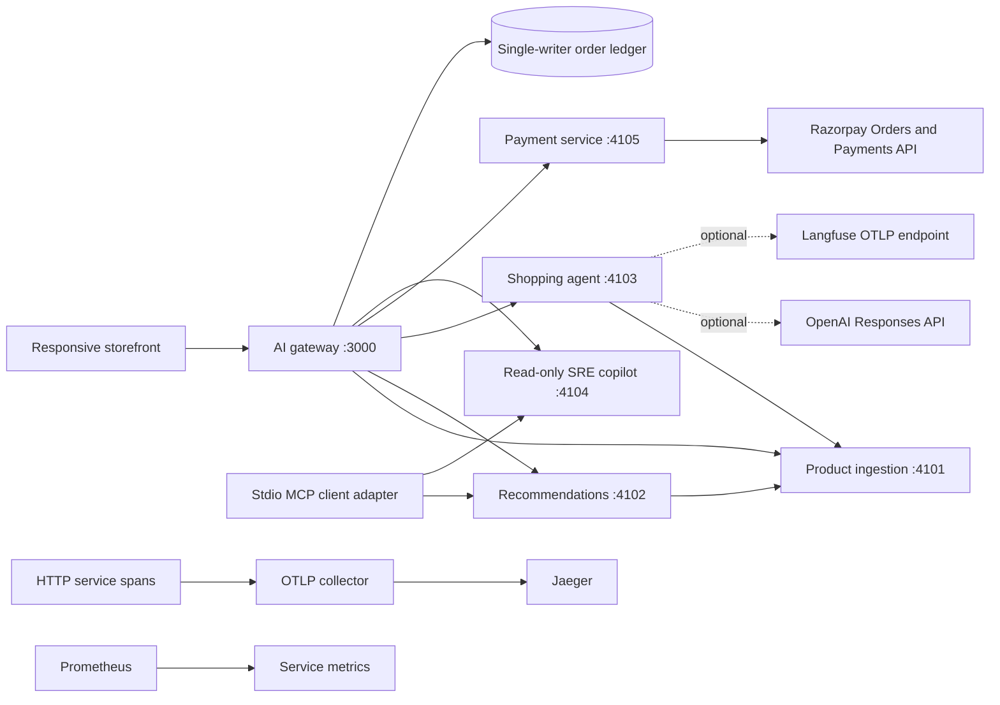

# Architecture

Only the gateway is exposed for application traffic. Browser requests are same-origin.
The catalogue is an imported immutable-at-runtime JSON snapshot. Recommendations and
assistant retrieval use that snapshot; the gateway supplies its sold-out exclusions.
Carts, stock decrements and idempotent payment orders are atomically saved in one JSON
file by one gateway process. The legacy account/payment services are independent.

All services expose liveness and metrics. Gateway readiness checks SRE health probes
for its dependencies. Traces propagate across internal HTTP calls; the manual exporter
is best-effort. SRE guidance is deterministic and non-mutating. MCP is stdio, not a
public HTTP endpoint. Model outputs are guidance only and cannot execute tools.

Razorpay checkout uses stock reservations, signature validation, captured-payment checks,
and signed webhook/status recovery. The legacy dummy payment route is not exposed.
