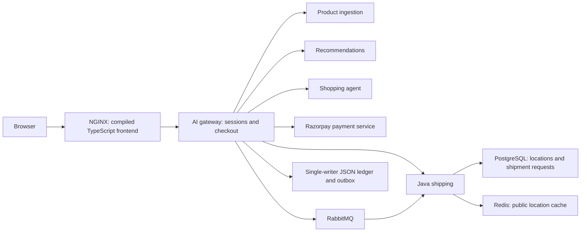

> Deployment-script cleanup: imperative application deployment commands in this
> document are retired. Use the Argo CD catalog and the five supported commands
> documented in `docs/operations/scripts.md`. Historical examples below are not
> runnable deployment instructions.

> Deployment update: orchestration now uses [Minikube](../../minikube/roboshop/README.md); older deployment descriptions below are historical. Use root `build-images.sh` and `scripts/deploy/deploy-minikube.sh`.

# Architecture review — 18 October 2026

The active application has useful service boundaries and verified payment checks,
but remains a development/reference platform. Moving files and adding TypeScript
does not make the order system highly available. The highest-priority production
work is a transactional order/inventory database and an operational payment lifecycle.

## Scope and deployment decision

Reviewed active Node HTTP services, shared request/trace code, catalogue validation
and retrieval, assistant fallback, read-only MCP tools, gateway sessions/ledger/outbox,
Razorpay verification, the Java/Gradle shipping database/cache/consumer/migrations,
storefront, NGINX, Compose, Helm, CI and telemetry configuration. The legacy tree is
an upstream reference, not a second implementation being modernized. Terraform VPC
and observability products were not provisioned or audited against a live environment.
This is a code/configuration review, not a penetration test or production certification.

All application/supporting-service source and local deployment configuration lives
under `services/`. Shared orchestration stays at root Compose and `infrastructure/helm`.
Frontend is a build unit served by NGINX, not an extra Node daemon. The gateway's
static fallback uses the same compiled output for local development. This avoids
introducing a second web-server hop with no SSR or frontend server logic to run.

NGINX/Redis/RabbitMQ/PostgreSQL each own a `compose.yml` consumed through root
`extends`. Paths are validated against the actual resolved Compose model. See
[Docker's Compose extension guidance](https://docs.docker.com/compose/how-tos/multiple-compose-files/extends/).
Production Helm continues to consume external PostgreSQL/Redis/RabbitMQ services;
local single-container definitions are not represented as production HA deployments.

## Fixed in this change

| Finding | Resolution and evidence |
| --- | --- |
| Untyped browser state and DOM access | Strict TypeScript contracts for products, cart, order states, shipping, service responses and Razorpay; missing required DOM elements fail explicitly. Build fails on type errors. |
| UI handlers waited for startup network calls | Registered shipping handlers before initialization requests. DOM test holds startup requests and verifies edits immediately invalidate checkout. |
| Expired stored payment reference blocked bag recovery | Only a confirmed 404 clears the stale reference; current-session order recovery follows. Network/provider failures preserve the reference. |
| SDK load failures could permanently poison checkout | Failed/missing SDK and a 15-second timeout reset the loader, enabling retry without creating a provider order. DOM tests assert no payment request is made. |
| Unicode address corruption across network chunks | Shared JSON body parser collects bounded bytes and decodes UTF-8 once. Regression test splits Hindi/Japanese/emoji data into individual bytes. |
| Supporting services lacked owned deployment/config files | Extracted Compose definitions and Redis/RabbitMQ configs. Resolved mount/build paths checked; gateway remains unpublished. |
| Unversioned JS/CSS could stay stale after a deployment | NGINX now requires revalidation for these files; public images keep caching. HTTP regression asserts JS revalidation. |
| Bootstrap DB passwords inherited by unrelated local processes | Development launcher strips the two Compose bootstrap passwords from every child; Java receives its designated database URL. |
| Deployment documentation had stale service counts/permissions | Updated Helm instructions, required Secrets, three image builds, service layout and shipment INSERT privilege. |

## Remaining findings, in priority order

| Priority | Evidence | Required follow-up |
| --- | --- | --- |
| High — order durability and scale | `services/ai-gateway/store.mjs` rewrites a single JSON file, holds orders in memory, caps history/sessions at 10,000, and has no transaction isolation across gateway processes. Rename provides atomic replacement but is not a database durability/replication strategy. | Move sessions/carts/orders/inventory/outbox to transactional SQL with unique idempotency constraints and stock locking. Add migration, recovery and concurrency tests before increasing replicas. Keep one gateway/Recreate meanwhile. |
| High — incomplete payment lifecycle | `creating`, `payment_pending` and `payment_review` reserve stock indefinitely. Session cookies expire after seven days; pending orders may then need operator recovery. Refunds, cancellation, scheduled reconciliation and account-based order recovery are absent. | Design reconciled expiry/cancellation, authenticated support tooling and refund states. Never release stock or retry a possibly successful charge merely because of a timeout. |
| High — deployment trust boundary | Helm exposes private ClusterIP services but installs no NetworkPolicies or service identity. `TRUST_PROXY=true` accepts a valid X-Real-IP from any direct caller; local Compose uses one shared network. | Restrict gateway ingress to NGINX and monitoring, restrict dependency access, and define trusted load-balancer CIDRs. Keep gateway off public host ports. Protect operational APIs for production. |
| High — self-hosted CI execution | Current `.github/workflows/ci.yml` runs push and PR code on a self-hosted runner; runner isolation and trust policy are not defined in this repository. Service containers also require an appropriate Linux/Docker runner. | Use ephemeral isolated runners without deployment credentials, define runner labels and restrict untrusted contributions. Preserve the chosen runner here; verify its configuration before enabling outside PR execution. |
| Medium — fulfillment stops at a request | Java writes `shipment_requests` and calculates distance-based prices; it does not purchase carrier labels, validate deliverability or track delivery. | Add carrier adapters, fulfillment transitions, address validation and operational workflows before offering real delivery. |
| Medium — broker recovery and event contracts | Confirmed publishing and duplicate handling are tested, but local RabbitMQ is one node. Consumer validation is shallow; DLQ replay and broker/data restore procedures are not automated. | Add versioned event schemas, consumer contract tests, replicated broker deployment, queue-depth/age alarms and tested replay/backup procedures. No exactly-once guarantee is claimed. |
| Medium — operational coverage | Current health view checks HTTP/SQL, not successful outbox drain. Error-ratio alert uses Node metrics; Java exports a different metric family. Outbox age, disk capacity, reconciliation backlog and DLQ backlog lack alerts. | Add service-specific SLOs/alerts, outbox and business metrics, restore drills and meaningful load/failure tests. Separate optional AI outages from checkout readiness policy where appropriate. |
| Medium — release and privacy controls | Images use tags; chart lacks explicit private-CA mounts. Address retention and deletion policies are undefined. TypeScript response types do not validate JSON at runtime. | Pin promoted image digests, scan artifacts, define CA/secret rotation and retention, and add runtime contracts where independently deployed APIs evolve. |

The read-only MCP interface, catalogue grounding, fallback behavior, server-priced
orders, raw webhook HMAC checks, captured amount/currency/order verification, cache
fallback, migration checksums and idempotent shipment insertion are useful existing
controls. They do not replace the missing operational features above.

## Validation

- Strict TypeScript build and DOM regressions passed.
- Full Node suite passed with real local PostgreSQL, Redis, RabbitMQ and NGINX,
  including HTTP/HTTPS, mocked Razorpay checkout, shipment delivery, duplicate events,
  dead-letter behavior, traces and dependency failure. No real charge was attempted.
- Gradle test/bootJar checks passed (unchanged Java tasks reused valid local outputs).
- Resolved Compose build/mount paths and Helm rendering/lint were checked.
- Docker daemon is unavailable here: actual image builds and container startup remain
  CI checks. Native installed service versions may differ from pinned container tags.
- No Kubernetes release or production configuration was changed. Browser DOM tests
  do not replace real-browser layout, accessibility or live merchant acceptance tests.
