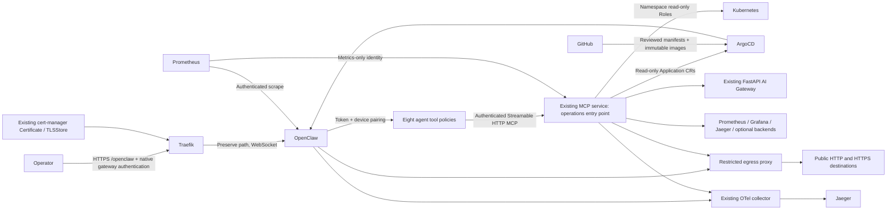

> Deployment-script cleanup: imperative application deployment commands in this
> document are retired. Use the Argo CD catalog and the five supported commands
> documented in `docs/operations/scripts.md`. Historical examples below are not
> runnable deployment instructions.

# OpenClaw Unified AI Operations

Status: implemented and locally exercised; **not deployed or live-verified**. See
[the implementation report](implementation-report.md) for dated evidence and blockers.
The GitOps path is `overlays/mk4`; it includes the deployment and authenticated
ingress together. Verify network, credentials, TLS and browser behavior after sync.

## Discovered platform and reuse

Read-only discovery on 26 October 2026 used the already selected `mk4` context.
There are four ARM64 Minikube nodes. The network daemon is
`kindest/kindnetd:v20260820-69b56db7`; this is the KIND routing/masquerading daemon,
not the separate Kindnet project with policy enforcement. No enforcement controller
was found. Existing NetworkPolicy objects do not prove enforcement.

The canonical certificate is the Ready cert-manager Certificate
`jithendar/jithendar-com`, backed by `jithendar-com-tls`. The only default Traefik
TLSStore is in `jithendar` and uses that Secret. Traefik entrypoints are `web` and
`websecure`. No certificate, cert-manager or ingress controller is added.
Argo CD is in `argocd`; discovery found no existing Applications to extend.
The default StorageClass is `standard` (`k8s.io/minikube-hostpath`, Delete reclaim
policy). Protect both the claim and its off-host backup; Minikube is not HA.

Existing application manifests live with services. The FastAPI gateway, MCP
service remains the public/customer boundary. Operations code
lives in the existing `services/mcp-server` build context, with a separate
`Dockerfile.operations`, runtime and identity. Reuse is through the gateway's
existing `/api/ops` endpoint, which reaches SRE diagnostics. Customer MCP tools
and their shopping-session authentication are unchanged. Operational permissions
are never granted to a customer session.

Prometheus and Grafana run in `monitoring` and preserve `/prometheus` and
`/grafana` even on internal service URLs. Jaeger and the OTel collector run in
`roboshop-ai`. Langfuse is **Cloud**, not a missing local deployment: the repository
retired self-hosting, and `roboshop-ai/langfuse-credentials` has the expected key
names. No secret values were inspected. Loki, Tempo and n8n were not found;
optional adapters do not install these services or fabricate observations.



## Pinned release and native integration

The official image is `ghcr.io/openclaw/openclaw:2026.10.7`, pinned additionally
to the GHCR manifest digest in `base/workloads.yaml`. Release source, package and
image registry were checked. This release supports `mcp.servers`, authenticated
`streamable-http`, `gateway.controlUi.basePath`, `/healthz`, `/startupz`, and
`agents.entries` with `agents.ownership: explicit`. We do not invent an MCP
plugin or route shopping sessions through an infrastructure adapter.

Official `@openclaw/diagnostics-otel` and `@openclaw/diagnostics-prometheus` packages
are pinned at 2026.10.7 in a lockfile. The operations image builds them separately;
a non-root initContainer copies their read-only package tree into an ephemeral
volume. The Gateway still runs the official image. There is no plugin download
or package install at runtime. `plugins.load.paths` and plugin registration were
validated with the pinned native runtime.

The configured model is `openai/gpt-5.4-mini`. Confirm that the operator's OpenAI
project can use it before enabling model traffic. No billable inference was run.
All eight agents have separate workspaces and exact tool-name allowlists:

| Agent | Tools / responsibility |
|---|---|
| orchestrator | All read-only evidence groups; correlate incidents |
| sre | Kubernetes diagnostics and Roboshop incidents |
| argocd | Application status, health, history and failures |
| github | Workflow failures, bounded job logs, PRs, dependency alerts and Terraform patches |
| aws | Regional inventory, EC2 CPU, alarms, Inspector and optional costs |
| observability | Metrics, quantiles, logs, traces, dashboards and generation metadata |
| roboshop | Application, Kubernetes, telemetry and deployment correlation |
| blog | Operator-selected RSS and inert draft MDX generation |

`AGENTS.md` is mounted read-only for each workspace. Shell, filesystem mutation,
web browsing, arbitrary network tools, plugin management, nodes, automation and
messaging tools are denied. No ambient heartbeat owner is configured deliberately;
OpenClaw's schema warning says scheduled heartbeats stay disabled.

Each MCP server entry presents a distinct opaque bearer token. Tool policy keeps
an agent on its own server, and the operations service independently enforces its
credential's group grants. Agents sharing one Gateway are **not mutually hostile
security tenants**: use separate deployments/identities for mutually untrusted
operators. The separate `monitor` credential has no operational tools.

## Tool behavior and evidence

`POST /v1/tools/{group}` and `/mcp` share authorization and adapters. GET-only
upstream paths are fixed in code; arguments cannot supply a URL, namespace, shell
command, HTTP method, PromQL or LogQL expression. The namespace defaults to the
observed `roboshop-ai` and is changed only by operator configuration plus RBAC.
Responses are bounded, redacted and labelled untrusted. A failure is an explicit
unavailable/error result, never a synthetic healthy result.

Kubernetes adapters project pod/workload status rather than exposing pod env,
commands and annotations. Logs are bounded to 100 lines / 16 KiB. Events are
queried by exact pod where available. Connectivity reports Services and
EndpointSlices; it does not execute inside application pods. CPU/memory comes
from the metrics API. CrashLoopBackOff, OOMKilled and image-pull failures are
observations, not automatically proven root causes. Deployment conditions expose
progress failures. Argo CD access uses Application CRs, avoiding an extra Argo
API credential; it never exposes an operation that syncs or rolls back.

```mermaid
sequenceDiagram
  participant U as Operator
  participant A as Roboshop agent
  participant T as Operations boundary
  participant K as Kubernetes
  participant O as Observability / Argo / gateway
  U->>A: Investigate why cart-service is failing
  A->>T: ops_roboshop(investigate, cart-service)
  T->>T: Authenticate, authorize, validate, bound execution
  T->>K: Pod/workload status, per-pod events and bounded logs
  K-->>T: Observations or unavailable
  T->>O: Metrics, revisions, traces, existing health diagnostics
  O-->>T: Evidence or unavailable
  T-->>A: Redacted evidence, observations, missing evidence
  A-->>U: Correlated hypothesis, confidence, recommendations
  Note over A,T: No write tools exist; evidence cannot authorize a change
  U->>U: Review and approve a separate operator/GitOps change
```

The deterministic investigation helper samples at most three matching pods;
manual read calls can inspect a specific additional pod. An overall evidence
budget bounds sequential HTTP work. SDK timeouts/retries are limited; local
admission is four worker slots. Rate limiting is per credential/process; keep
one operations replica unless a shared limiter is implemented. Unknown failures
are sanitized. Audit records contain agent, tool, operation and outcome, not
arguments, results, credential-bearing URLs, prompts or exception text.

GitHub logs follow only the API-provided HTTPS Azure Blob redirect and never
forward GitHub authentication. Large logs are rejected rather than downloaded
without a bound. PR/file lists are intentionally bounded and may need manual
pagination for large changes. No merge, repository write or branch-protection
bypass endpoint exists. `scripts/openclaw/propose_pr.py` prepares an isolated
worktree from a human-reviewed patch and can publish a **draft** PR only after an
interactive confirmation. It does not execute the patch. Inspect it for secrets
and malicious code before publishing.

AWS uses boto3's existing credential chain. Static access keys without a session
token are rejected. Supply a supported external short-lived credential mechanism
or rotate temporary STS sessions; no IRSA assumption is made. `aws-policy.json`
contains only the adapter's reads; remove optional IAM/Cost Explorer statements
when not needed, and set the intended region. AWS account setup, role trust and
credential rotation require external authorization. Add exact regional AWS
endpoints to the proxy ACL before enabling them. No broad `ReadOnlyAccess`
managed policy is attached by this implementation.

RSS requires `RSS_URL` pointing to a public HTTP or HTTPS endpoint. Entity-bearing XML is
rejected, and returned links are never fetched automatically. Draft MDX escapes
JSX/expression delimiters and has `draft: true`. The live site is WordPress; an
MDX publication repository/path has not been identified. Do not send drafts to
WordPress or publish them automatically. n8n is absent and is not installed.

## Security and public exposure

The namespace enforces restricted Pod Security. All containers are non-root,
read-only-root, drop every capability and use RuntimeDefault seccomp. The gateway
has no Kubernetes token. Only operations receives a projected, rotating service
account token. Its namespace Roles allow get/list for pods/logs, events, services,
workloads, EndpointSlices and pod metrics, plus Argo Applications in `argocd`.
There is no cluster-admin, Secrets read, exec/attach, host mount or Docker socket.

Default-deny NetworkPolicies allow exact internal paths. Only the egress proxy
can reach public TCP 443. Squid permits CONNECT to OpenAI, GitHub and the Azure
log-storage suffix; internal proxy routes are limited to operations and OTel.
Private destinations are denied after those exact exceptions. Optional AWS,
Langfuse Cloud and RSS hosts must be reviewed and added explicitly. Metadata
IP ranges are denied. This protection **requires a working policy engine**;
Squid alone does not prevent a compromised pod from bypassing it.

`overlays/mk4/ingress.yaml` preserves `/openclaw`, enables only `websecure`,
references the shared TLSStore implicitly and adds BasicAuth, cookie removal,
CSP, frame denial and no-store headers. Any IP is allowed as requested.
There is no StripPrefix or separate public overlay.
WebSockets use the same route; BasicAuth is removed before forwarding because
OpenClaw authenticates its own protocol with a separate token/device identity.
No HTTP route is added, so the existing website's HTTP behavior is preserved.

**Shared-origin residual risk:** a path does not isolate browser storage or
same-origin scripts from WordPress/Roboshop. A same-origin compromise can threaten
an operator session. CSP and BasicAuth do not create an origin boundary. Keep
access restricted to operator network/VPN ranges and use a dedicated browser
profile that does not browse the website. Device pairing stays enabled. This is
one operator trust boundary; do not call it safe for untrusted multi-tenancy.
Public activation requires explicit acceptance of this constraint, per the
requested same-host path. No gateway token belongs in a URL or Git.

## Secrets and first bootstrap

Native Secrets are external inputs, never generated by the ConfigMap/Kustomize
render. Keep source credential files outside Git with mode 0600 and provision
through your approved secret workflow. The initial operator bootstrap requires:

| Namespace / Secret | Required keys |
|---|---|
| openclaw / openclaw-gateway-secrets | `OPENAI_API_KEY`, `OPENCLAW_GATEWAY_TOKEN`, `OPS_ORCHESTRATOR_TOKEN`, `OPS_SRE_TOKEN`, `OPS_ARGOCD_TOKEN`, `OPS_GITHUB_TOKEN`, `OPS_AWS_TOKEN`, `OPS_OBSERVABILITY_TOKEN`, `OPS_ROBOSHOP_TOKEN`, `OPS_BLOG_TOKEN` |
| openclaw / openclaw-operations-identities | `identities.json`: agent → corresponding distinct token; add `monitor` |
| openclaw / openclaw-registry | `.dockerconfigjson` for existing ECR registry |
| openclaw / openclaw-edge-auth | `users`: legacy bcrypt htpasswd entry, retained only for rollback; not used by ingress |
| openclaw / openclaw-integration-secrets | Optional `GITHUB_TOKEN`, `GRAFANA_TOKEN`, `LANGFUSE_PUBLIC_KEY`, `LANGFUSE_SECRET_KEY`, `LANGFUSE_URL`, approved AWS temporary credential settings |
| monitoring / openclaw-metrics-auth | `token`: metrics-only operations token; `gateway-token`: OpenClaw gateway token |

For initial provisioning, run `python3 scripts/openclaw/prepare_secrets.py
--output "$HOME/.local/state/openclaw/initial-secrets.json"` on one line. It prompts
privately for the OpenAI API key and writes a mode-0600 manifest outside Git with
matching generated gateway, agent, and monitoring credentials. Then use
`kubectl --context "$OPENCLAW_CONTEXT" create -f
"$HOME/.local/state/openclaw/initial-secrets.json"` on one line. Both namespaces
must already exist. Creation refuses to overwrite existing Secrets. If creation
partially succeeds, retain the same file and investigate; do not generate new
mismatched tokens or use this helper to rotate existing credentials.

Operations identity tokens must be distinct and at least 32 characters. Rotate
both ends together and restart the corresponding Deployments through GitOps.
Secrets are read on startup; authentication does not keep a revocation cache.
The monitoring token cannot execute any tool. Protect the gateway token mounted
into Prometheus: it grants the gateway's operator access, not just metrics.

Reuse Langfuse Cloud project settings only after approval. The existing key name
is `LANGFUSE_BASE_URL`; map it to this adapter's `LANGFUSE_URL`. The operations
service projects generation metadata only; it discards input/output text. OTel
exports go to the existing collector/Jaeger, not a new Langfuse installation.

## Deployment sequence

1. Review and merge the repository changes under existing branch protection.
   Nothing here has been committed, pushed or merged automatically.
2. Approve and implement a compatible NetworkPolicy enforcement change without
   recreating the cluster. This is a separate security-sensitive cluster change.
   Run the isolated test below after that change. It tests allowed, denied and
   recovered connections and removes only its temporary namespace.
3. Build/publish with **OpenClaw operations image** in GitHub Actions. It reuses
   `roboshop-mcp-server` in the existing ECR registry with an `openclaw-<SHA>` tag.
   Record the returned digest for both operations and the telemetry initContainer.
   Replace the deliberate `REPLACE_WITH_COMMIT_SHA` image placeholders in a
   reviewed GitOps commit. No Docker engine was available for a local image build.
4. Initial bootstrap: create only the new namespace and external Secret inputs
   through the approved operator workflow. No new OpenAI/GitHub/AWS credentials
   were created during this task. Refresh ECR credentials using the script below.
5. Enable the registry-refresh workflow only after setting repository variables
   `OPENCLAW_REGISTRY_REFRESH_ENABLED=true` and `OPENCLAW_CONTEXT=mk4`. The existing
   runner's AWS and Kubernetes identities must be scoped to ECR pulls and the
   one pull Secret. The six-hour schedule maintains the twelve-hour credential;
   it is disabled by default. Failed refreshes must alert the operator.
6. Run validation and `doctor`; review all blockers. Bootstrap only the dedicated
   AppProject/Application, never direct-apply the managed workloads. Argo uses
   automated sync/self-heal; automatic prune is disabled. The Application has no
   cascading deletion finalizer, and namespace/PVC have Prune=false,Delete=false.
7. Verify private rollout, plugin load, MCP authentication, allowed/denied RBAC,
   proxy allow/deny and the chosen model's access before changing public routing.
8. Add the monitoring ConfigMap through an existing monitoring GitOps owner.
   Merge the optional Prometheus/Grafana values into their existing releases.
   Avoid a second controller managing the same Helm resources.
9. Ensure gateway token authentication is enabled before syncing `overlays/mk4`, then validate
   the `/openclaw` route and TLS. Ingress and workloads use the same overlay.
10. Verify with a dedicated browser: HTTPS certificate, gateway login, device pairing,
    WebSocket connection and a read-only investigation. Do not mark deployment
    complete until this passes with real evidence.

```bash
export OPENCLAW_CONTEXT=mk4  # must already be the current context
export PYTHON="$(command -v python3)"  # activated environment with dependencies
./scripts/openclaw.sh doctor
./scripts/openclaw.sh validate
./scripts/openclaw.sh test
# Only after NetworkPolicy enforcement is enabled:
install -d -m 700 "$HOME/.local/state/openclaw"
"$PYTHON" scripts/openclaw/network_smoke.py --output "$HOME/.local/state/openclaw/network-evidence.json"
export OPENCLAW_NETWORK_EVIDENCE="$HOME/.local/state/openclaw/network-evidence.json"
# Create the namespace before provisioning the external secrets described above.
kubectl --context "$OPENCLAW_CONTEXT" apply -f minikube/openclaw/base/namespace.yaml
"$PYTHON" scripts/openclaw/refresh_registry.py
./scripts/openclaw.sh bootstrap  # Argo CD starts automatic synchronization
./scripts/openclaw.sh status
./scripts/openclaw.sh logs
```

The network test retries API/exec transport failures three times; these failures
never count as denied connections. Evidence is written only after a successful
positive control, three consecutive remote connection denials, and recovery.
If the test fails, stop before bootstrap and resolve the reported issue. A
cleanup request may leave its temporary namespace Terminating briefly. Use a
new output filename when refreshing existing evidence; the script does not
overwrite previous evidence.

Changing commands require interactive confirmation. Evidence is valid for one day
and must identify the current context. No script switches kube contexts. The
`bootstrap` command assumes approved initial namespace/Secrets exist and applies
only the Argo resources. `deploy` requests an Argo Application sync operation in the explicit context
and waits for that operation to report Synced/Healthy; it never overwrites
application Deployments directly or relies on a stale Argo CLI login.

## Monitoring and tracing

Operations emits `openclaw.request`, `agent.sre.investigate` and bounded
`tool.<group>.<operation>` spans, including nested evidence calls. The official
OpenClaw exporters retain their release-defined span names. We do not claim
that every upstream span is renamed. Content capture is disabled. Kubernetes
logs and tool text do not become span attributes. Audit logs go to stdout for
existing log collection; Loki retention is not configured because Loki is absent.

The Grafana JSON has gateway availability, integration errors, tool/agent/LLM
latency, token use, authentication failures, memory and AI Gateway p99. Alerts
cover gateway/operations scrape failures, integration errors, auth failures,
slow tools/LLM, memory pressure and a configurable token budget. The gateway's
new histogram supports p50/p90/p95/p99 after its image is redeployed and scraped.
Other services with only sum/count summaries cannot yield quantiles; empty series
are reported as missing evidence. Tune alert thresholds to your budget and SLOs.

```bash
kubectl kustomize minikube/openclaw/monitoring
helm template prometheus minikube/monitoring/prometheus -n monitoring \
  -f minikube/openclaw/monitoring/prometheus-values.yaml
```

Do not install these rendered resources manually over another GitOps owner.
Prometheus scrapes `/api/diagnostics/prometheus` internally with gateway auth;
that endpoint is outside the public `/openclaw` ingress path.

## Backup, recovery and rollback

```bash
./scripts/openclaw.sh backup --output /secure/backups/openclaw-2026-10-26.age \
  --recipient AGE_PUBLIC_RECIPIENT
./scripts/openclaw.sh restore --archive /secure/backups/openclaw-2026-10-26.age \
  --identity /secure/age-key.txt --target /secure/recovery/new-openclaw
./scripts/openclaw.sh rollback --revision OPENCLAW_ONLY_COMMIT_SHA
```

Backup uses upstream SQLite-aware `backup create --verify`, streams the archive
through `age` and stores no plaintext locally. A failed transfer leaves the remote
archive for recovery; a failed local output is not a usable backup. Store verified
encrypted archives off-host with retention and restore drills. The 256 MiB temp
volume limits backup size; increase it through GitOps if state grows. Backup
commands can emit paths but the wrapper does not print archived content.

Restore verifies the upstream archive and extracts only to a **new local directory**.
It does not overwrite live state. For an approved live recovery: stop public ingress,
suspend Argo auto-sync in a reviewed change, scale Gateway to zero through Git,
create a new protected PVC, securely transfer the verified restored state with
UID/GID 1000, change the claim reference, then resume sync and verify. Retain the
old PVC until the recovery point is accepted. Never extract arbitrary tar files
into the running Gateway or delete its PVC to fix permissions.

Rollback prepares a local revert only for an isolated OpenClaw commit and refuses
a dirty worktree. Review/push the rollback through normal protection. For a mixed
commit, prepare a dedicated revert PR manually. Reverting a database migration
may require the matching pre-upgrade backup; changing the image alone is not
always a state rollback. Argo `app rollback` is deliberately not exposed to agents
and would conflict with automated reconciliation.

## Troubleshooting and extension

- `doctor` reports kindnet: stop; existing NetworkPolicy YAML is not enforcement.
- PVC Pending/permission error: inspect binding, node affinity and fsGroup support.
  Never add a privileged chown initContainer or delete data as an automatic fix.
- ImagePullBackOff: verify immutable image publication and ECR credential renewal.
- Plugins unavailable: inspect initContainer and exact package load paths. Do not
  enable arbitrary ClawHub installation to bypass a build issue.
- UI 401/403: distinguish edge BasicAuth/IP policy from Gateway pairing/token.
  Do not disable auth or device checks. Do not add StripPrefix.
- MCP unavailable: check per-agent token mapping, Service DNS, proxy and policy.
  Request bodies are at most 32 KiB and responses have bounded evidence size.
- Empty metrics: check internal URL base path, scraping and actual metric names.
- AWS/Langfuse/GitHub unavailable: check endpoint reachability and credentials without
  logging them. No automatic fallback to broader access occurs.

To add a tool, extend the closed `GROUPS` vocabulary, implement a fixed destination
read adapter, add credential grants and per-agent exact names, then add mocked
success, timeout, auth-denial, injection and response-bound tests. Add only the
specific RBAC verbs/resources needed. Writes require a separate reviewed approval
protocol; never add an `approved: true` model-supplied boolean. Adding an agent
requires a distinct Secret token, identities entry, `agents.entries`, MCP server
entry, read-only workspace instruction and allowlist tests.

Sources checked against release v2026.10.7:
- [Official Docker guide](https://docs.openclaw.ai/install/docker)
- [Native MCP configuration](https://github.com/openclaw/openclaw/blob/v2026.10.7/docs/gateway/config-extensions.md)
- [Gateway configuration](https://github.com/openclaw/openclaw/blob/v2026.10.7/docs/gateway/config-gateway.md)
- [Agent entries](https://github.com/openclaw/openclaw/blob/v2026.10.7/docs/gateway/config-agents/entries-and-multi-agent.md)
- [Prometheus plugin](https://github.com/openclaw/openclaw/blob/v2026.10.7/docs/gateway/prometheus.md)
- [Managed egress proxy](https://github.com/openclaw/openclaw/blob/v2026.10.7/docs/security/network-proxy.md)
- [Backup CLI](https://github.com/openclaw/openclaw/blob/v2026.10.7/docs/cli/backup.md)
- [KIND kindnetd scope](https://github.com/kubernetes-sigs/kind/blob/main/images/kindnetd/README.md)

Post-deployment verification commands (read-only):

```bash
python scripts/openclaw/verify_rbac.py
# Supply edge credentials via a private environment; never put them in argv/history.
python scripts/openclaw/verify_public.py
```

The public checker verifies the real certificate chain, unauthenticated rejection,
authenticated UI response and WSS challenge. It deliberately does not call an LLM
or claim that browser pairing and incident investigation have been verified.

### ECR 403 from the Minikube pull identity

OpenClaw pulls `roboshop-mcp-server` from account `881026659929` in
`us-east-1`. The pinned digest was verified in that repository. No cross-account
repository policy is required. Both workload images and the registry refresh
script must use this account. The Argo CD Application includes an image mapping
for the old registry so a checkout of the previous revision also pulls correctly.

```bash
export OPENCLAW_CONTEXT=mk4
python3 scripts/openclaw/refresh_registry.py
kubectl --context "$OPENCLAW_CONTEXT" apply -f argocd/openclaw.yaml
```

Use `--profile` or `OPENCLAW_ECR_PROFILE` to select another authorized AWS
profile. Refresh validates image access before replacing the secret. Scheduled
refresh accepts the optional GitHub variable `OPENCLAW_ECR_PROFILE`; an empty
value uses the runner's default AWS credential chain.

Argo CD Application and AppProject manifests are now centralized in
`argocd/openclaw.yaml` and `argocd/project-openclaw.yaml`. The management script
uses these paths; see `argocd/README.md` for the complete cluster application catalog.

### Minikube persistent-state node placement

The `mk4` overlay pins the gateway to node `mk4`, where the
`k8s.io/minikube-hostpath` provisioner creates the `openclaw-state` directory.
This storage is node-local: scheduling on another worker can create an empty,
root-owned directory at the same path, causing `EACCES` during startup. The
operations and egress deployments remain free to schedule on other nodes.
Keep this placement until state is migrated to storage that supports multi-node
scheduling; do not remove it merely to move the gateway to a different worker.

### OpenClaw ingress

The Argo CD Application selects the single `mk4` overlay and serves
`https://jithendar.com/openclaw` through Traefik's existing TLS configuration.
Access is allowed from any IP. OpenClaw's native gateway token authentication
and device pairing protect access. The UI shell is publicly reachable, but
protected gateway operations still require authentication. Do not attach the
legacy BasicAuth middleware: it conflicts with the UI's Bearer Authorization
header and causes repeated browser password challenges. The unused middleware
and edge Secret remain for rollback only; the old ingress username/password
are no longer used. Enter the gateway token in OpenClaw and approve pairing
for new devices as needed.
The route preserves `/openclaw` and does not expose the operations service.

### Container startup and proxy attribution

The gateway requests 1 GiB and has a 4 GiB memory limit. The previous 2 GiB
limit caused OOM kills during gateway use and interrupted browser sessions.

The init container stages a writable configuration under `/runtime-config/config`
and copies any existing state into the UID-1000-owned `runtime` subdirectory of
the PVC on first initialization. Original state files are preserved. The gateway
mounts that subdirectory at `/home/node/.openclaw`; its image filesystem remains
read-only. The official image runs `doctor --fix` before gateway startup, so
configuration files and the state directory must support owner permission changes.
Plugin paths use the actual `/opt/openclaw-plugins` mount.

`gateway.trustedProxies` currently contains only `10.244.2.2/32`, the verified
Traefik pod address. If Traefik is recreated with a new IP, update this exact
address from `kubectl -n traefik get pods -o wide` and sync OpenClaw. Do not replace
it with a wildcard or the entire cluster subnet. Edge BasicAuth and gateway
authentication remain enabled.

### One-command local patches

`argocd/openclaw.yaml` is a plain Application manifest. To apply the local
OpenClaw fixes without embedding large patch strings in that file:

```bash
./patch-openclaw.sh --dry-run  # preview; no cluster writes
./patch-openclaw.sh           # patch the existing Application and request sync
```

The script reads workloads, config, ingress and node placement from their normal
manifest files. It checks the current context (default `mk4`), refuses to replace
an active sync operation, and sends overrides through Argo CD. It does not write
workloads directly, prune resources or create credentials. It requires Python
with PyYAML and kubectl. Use `KUBE_CONTEXT` to select another already-current
context. After the desired manifests are published to Git, normal Argo CD sync
can use the plain Application without these temporary source overrides.

`Apply OpenClaw patches` runs `patch-openclaw.sh` automatically on pushes to
`master` that change the script, Application, OpenClaw manifests or its workflow.
It also supports manual Actions dispatch. It runs on the existing self-hosted
Linux ARM64 runner with its Kubernetes credentials, using `OPENCLAW_CONTEXT`
(repository variable, default `mk4`). The runner's current context must match.
The workflow validates/render-checks first, waits for any active Argo operation,
and serializes patch runs. It requests sync; successful workflow completion
alone does not certify application readiness. No patch runs on pull requests.

### Installing channel plugins

The proxy allows outbound HTTP (80) and HTTPS (443) to any public hostname.
Private, loopback, link-local and cloud metadata addresses remain blocked, except
for the explicitly configured in-cluster operations and collector endpoints.
The proxy is internal-only; this does not expose an inbound public proxy.

npm uses `/tmp/npm-cache`. The `temp-permissions` init container sets the shared
owned emptyDir subdirectory to mode `1777`, then mounts that subdirectory at
`/tmp`, restoring sticky protection before OpenClaw starts. All containers,
including this init step, run as UID 1000 with all capabilities dropped. The
gateway retains a read-only root filesystem.
`patch-openclaw.sh` restarts Squid when its configuration checksum changes.
Plugin versions should match the pinned gateway release.

### Public pairing address

Device setup codes advertise `wss://jithendar.com/openclaw` through
`plugins.entries.device-pair.config.publicUrl`. The core pairing resolver reads
this setting even with the optional slash-command plugin disabled.
`gateway.publicOrigin` alone falls back to the pod LAN address for device pairing.
After changing the address, generate a new setup code; existing codes retain their old URL.

### Internal MCP through the egress proxy

Squid uses `dns_defnames on` to resolve Kubernetes service names ending in `.svc`
with the pod DNS search domains. The operations NetworkPolicy admits the
`openclaw-egress` pods in the `openclaw` namespace on TCP 4180, in addition to
direct gateway traffic. Both are required because the gateway uses CONNECT
tunnels for its MCP HTTP requests. `ERR_DNS_FAIL` indicates DNS resolution;
`ERR_CONNECT_FAIL` after resolution can indicate a missing destination ingress rule.
